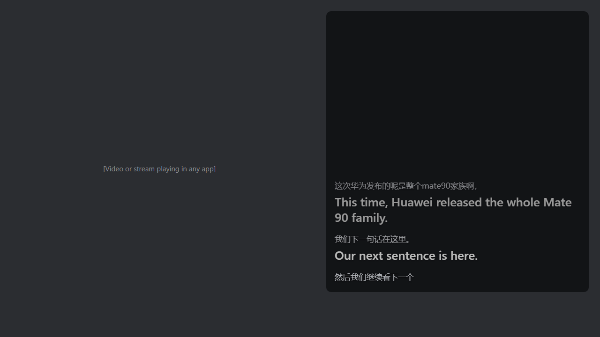

# Live Translation

Live English captions for Chinese speech on Windows, and translation of Chinese text on the screen. All processing is on the PC.

The app captures the audio that the PC plays (all audio, or only selected apps). It recognizes the Chinese with a streaming X-ASR model and translates it with a local llama.cpp model. The Chinese appears while it is spoken. The English follows when the sentence or phrase ends.

A hotkey (Ctrl+Shift+A) also translates text on the screen. The app freezes the monitor, reads the Chinese in a box that you drag with a PP-OCRv6 text recognizer, and paints the English over it.



Rust core, Tauri 2 shell, Svelte UI. Translation: Hy-MT2 1.8B. Screen text recognition: PP-OCRv6.

## Requirements

- Windows 10 or 11, x86-64, AVX2, 4 cores and 8 GB RAM minimum (6 cores and 16 GB recommended).
- For development: Rust (rustup), Node.js 22.12+, Python 3.11+, Visual Studio Build Tools with "Desktop development with C++".

## Quick start

```powershell
git clone <repo-url> live-translation
cd live-translation
./scripts/setup.ps1 -Models      # check tools, download runtimes, packages and models
./scripts/check.ps1              # all checks

. ./scripts/env.ps1
npm --prefix app/ui run build
cargo run -p live-translation    # the app
```

`./scripts/package.ps1 -Version 0.8.0` makes the zip in `dist/`.

## Models

The repository does not contain models. The app downloads the speech and translation models at first run, and the 23 MB screen text model when you first use screenshot translation. Developers use `scripts/setup.ps1 -Models`, which downloads all of them. See [docs/models.md](docs/models.md).

## Documents

- [Architecture](docs/architecture.md)
- [Development](docs/development.md)
- [Configuration](docs/configuration.md)
- [Core ↔ UI contract](docs/ipc.md)
- [Models and runtime](docs/models.md)
- [User guide](docs/USER-README.md)
